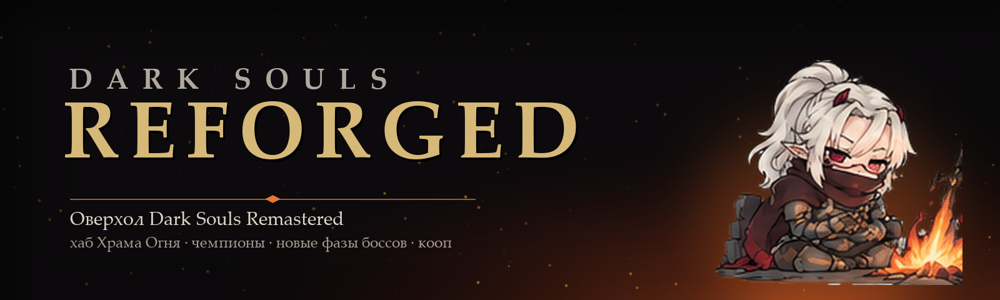
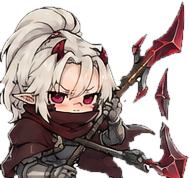
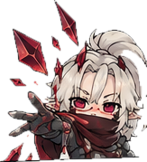
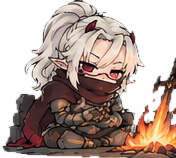
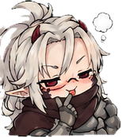
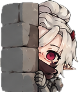
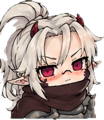
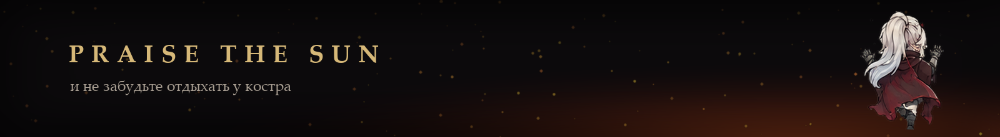

<p align="center">
  
</p>

<p align="center">
  
  
  
  
  
</p>

<p align="center">
  <b>Большой оверхол Dark Souls Remastered.</b><br>
  Мир, атмосфера и лор первой части — но сложнее за счёт поведения врагов, а не раздутого HP.<br>
  Храм Огня становится домом, боссы получают свои вторые фазы, а кооператив — новые причины играть вдвоём.
</p>

<p align="center"><sub><i>A Dark Souls Remastered overhaul: a living Firelink hub, champions and invasions, reworked bosses,
co-op first. Texts: Russian and English.</i></sub></p>

---

##  Что внутри

<table>
<tr>
<td width="50%" valign="top">

###  Храм Огня как дом
Торговцы, Андре и Гигант-кузнец переезжают в Храм по ходу сюжета, Храм обрастает декором.
Удручённый воин у костра даёт советы и **поручения на чемпионов**. Камень перерождения —
перераспределить характеристики у Анастасии.

</td>
<td width="50%" valign="top">

###  Боссы со своим характером
Без шаблонов: у каждого босса своя вторая фаза, настраиваемая отдельно. Первый — **Демон-телец**:
с половины HP он чаще прыгает и разрывает дистанцию. ИИ пересобирается из скриптов самой игры.

</td>
</tr>
<tr>
<td valign="top">

###  Чемпионы и вторжения
Одноразовые мини-боссы из других земель с особыми чертами и наградами, NPC-захватчики,
засады с баррикадами, гости из DLC и отряды людей в своём снаряжении. В NG+ — ещё больше.

</td>
<td valign="top">

###  Эстус и выживание
В начале **3 фляги**. Осколки эстуса с сильных боссов возжигаются у костра — до 10.
Камни жизни лечат медленно, янтарные травы возвращают заряды заклинаний — запас ограничен.

</td>
</tr>
<tr>
<td valign="top">

###  Магия и билды
Новые заклинания (Золотой обет, Стойкость, Благодатный дождь, Град Фаррона и другие), клирик со стартовым
набором из трёх чудес, пересмотр бесполезного оружия, кольцо серии ударов.

</td>
<td valign="top">

###  Кооператив
Лечение и групповые баффы действуют на союзников (из мода [AllyHeal](https://github.com/IHitawI/AllyHeal)),
награды с боссов и чемпионов получают оба игрока, ковенанты прокачиваются без онлайна.

</td>
</tr>
<tr>
<td valign="top">

###  Бой
Перекаты на ступень легче, враги быстрее доворачивают в атаке, дольше преследуют и нападают по двое.
Капра без лотереи на двух собак, яд Чумного города вдвое мягче.

</td>
<td valign="top">

###  Костры и путешествия
11 вырезанных разработчиками костров возвращены в игру. После Сосуда Повелителя — перенос к **любому**
зажжённому костру, всего 55.

</td>
</tr>
</table>

---

##  Состояние

Проект в активной разработке, всё проверяется прохождениями в кооперативе. Честный статус:

| | |
|---|---|
| ✅ **Видели в игре** | перекаты, Капра с одной собакой, торговец в Храме, лечение союзников, большинство заклинаний, чемпионы и тёмные духи, меню у костров |
| 🟡 **Собрано, ждёт проверки** | восстановленные костры, перенос между кострами, засады и декор, эстус и осколки, лимиты камней и трав, переезды NPC, ковенанты, NG+ |
| 🧪 **Прототип** | новая вторая фаза Тельца (пересобранный ИИ) |
| 🔧 **Известные проблемы** | у нового клирика 1 ячейка заклинаний вместо 3; напарник не бьёт врага во время удара в спину |

Подробный маршрут проверки — [ПРОВЕРКА.md](FirelinkHub_mod/ПРОВЕРКА.md), найденное в прохождениях —
[ЗАМЕЧАНИЯ.md](FirelinkHub_mod/ЗАМЕЧАНИЯ.md).

---

##  Дорожная карта

| Версия | Название | Что входит |
|---|---|---|
| **0.5** | Rebirth | фундамент: довести до рабочего состояния всё уже написанное, клирик, перенос, кооп |
| **0.6** | Covenants & Rituals | ритуалы у костров после Вихря: кольца наследия с печатями-штрафами, запретные заклинания |
| **0.7** | Lordran | ранние и средние боссы: свои вторые фазы, комбинации, отступления |
| **0.8** | Lords & Legends | Орнштейн и Смоуг с передачей инициативы, Присцилла и Защитник, Арториас, Сит, Гвиндолин |
| **0.9** | Age of Abyss | Четыре короля одновременно, новое Ложе Хаоса |
| **1.0** | Age of Reforging | «Решить судьбу Огня» у костра Храма, печати и NG+, полировка |

Дизайн и оценка реализуемости: [дорожная карта](docs/Roadmap_2026-10-20.md) ·
[технический аудит](docs/ТЕХАУДИТ_2026-10-20.md) · [GDD](docs/Dark_Souls_Reforged_GDD.docx).
Порядок версий может меняться по итогам прототипов.

---

##  Установка

> Готовых релизов пока нет — мод собирается из исходников (см. ниже). Архивы появятся в
> [Releases](https://github.com/IHitawI/DarkSoulsReforged/releases).

1. Dark Souls Remastered (Steam) и [ModEngine2](https://github.com/soulsmods/ModEngine2).
2. Папка мода `FirelinkHub` — в `ModEngine2\`, подключить её в `config_darksoulsremastered.toml`.
3. Для кооператива — Seamless Co-op (Nexus Mods);
   **у всех игроков должна быть одна и та же сборка мода.**
4. Мод заменяет AllyHeal (оба меняют GameParam) — AllyHeal отдельно ставить не нужно.

> ⚠️ Только для игры в закрытой компании. С изменёнными параметрами на официальных серверах есть риск
> софт-бана.

---

##  Для разработчиков

```
cd work
python build.py      # сборка (по умолчанию с меню отладки у костров)
python audit.py      # проверка флагов, карт и меню: должно быть "problems: 0"
python install.py    # копия в ModEngine2\FirelinkHub
```

Структура, зависимости и всё, чего нет в репозитории, — [docs/BUILD.md](docs/BUILD.md).
Полный отчёт о проекте для нового участника или ИИ-агента — [docs/ОТЧЁТ_ДЛЯ_АГЕНТА.md](docs/ОТЧЁТ_ДЛЯ_АГЕНТА.md).

---

##  Благодарности

- **Grimrukh** — [soulstruct](https://github.com/Grimrukh/soulstruct), [SoulsAI](https://github.com/Grimrukh/SoulsAI),
  аддон soulstruct для Blender; через soulstruct — DSLuaDecompiler (katalash).
- **thefifthmatt** — ESDLang / esdtool (диалоги).
- **TKGP / JKAnderson** — DSR Gadget (адреса памяти игры).
- **soulsmods** — ModEngine2. **LukeYui** — Seamless Co-op.
- **Lua.org** — Lua 5.0.3, **Zig** — компилятор для DLL и luac.
- Элион — стикеры автора проекта.

Dark Souls — торговая марка FromSoftware / Bandai Namco. Это фанатский некоммерческий мод.

<p align="center">
  
</p>
